<div align="center">



<a href="https://github.com/Vloxol"></a>

</div>

<br>

```text
$ whoami
vloxol

$ ls ~/projects
ls: cannot open directory: Permission denied

$ tail -n 1 /var/log/mood
[ 03:52 ] still awake
```

<br>

<div align="center">


<br>

<a href="https://github.com/Vloxol/CampusConnect"></a>
<a href="https://github.com/Vloxol/code2chill"></a>

<br>

<!-- swap in your real links; delete any you don't want -->
[](https://www.linkedin.com/in/YOUR-HANDLE)
[](https://instagram.com/YOUR-HANDLE)
[](mailto:YOUR-EMAIL)


</div>
